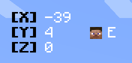
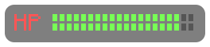
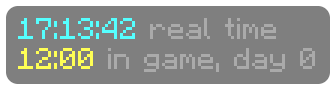
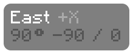

# Examples

Copy any of these into a Custom Script element and change them however you like.

## Bold coordinates with your head

Bold black labels, white numbers, and your head with the way you're facing beside Y. Turn the background off in the HUD Designer so it sits right on the world.

```
&0&l[X] &r&f{block.x}
&0&l[Y] &r&f{block.y}{tab}   {head} {cardinal.short}
&0&l[Z] &r&f{block.z}
```



## Potion effects with numbers

Levels as numbers instead of Roman numerals, with one effect left out. Add more ids to the list to hide them too.

```
{for e in effects}
{if e.id not in ["jump_boost"]}
{e.icon(2)} {e.color}&l{e.name}{if e.level > 1} {e.level}{end}
{e.duration <= 10 ? "&c" : "&f"}{e.time}
{end}
{end}
```


## Bed Wars resources in a row

```
{for id in ["iron_ingot", "gold_ingot", "diamond", "emerald"]}{item(id).icon}&f{item(id).count}  {end}
```


## Health bar

One bar per half heart, colored from red to green as your health changes.

```
&cHP &l{gradient(health, 0, max_health, "red", "yellow", "green")}{repeat("|", health)}&8{repeat("|", max_health - health)}
```



## Clock

The real time next to the in-game time and day.

```
&b{now("HH:mm:ss")} &7real time
&e{time} &7in game, day {day}
```



## Compass

```
&f{facing} &7{facing.axis}
&8{facing.bearing}° {yaw | round(1)} / {pitch | round(1)}
```



## Precise reach

The distance to the exact spot your crosshair hit, with every digit, a lot like extra precision reach display mods.

```
&bReach &f{reach | exact} &7blocks
```

## Smooth FPS

Changes once a second like the FPS element, and counts up or down to each new number.

```
&e{fps | smooth} &7FPS
```
