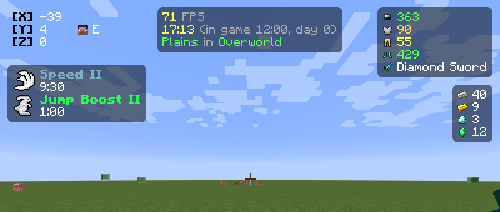
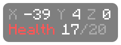
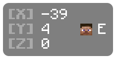
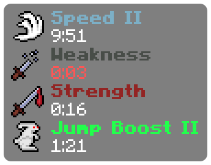
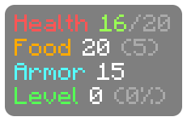
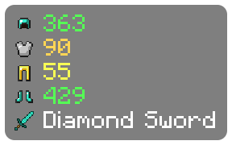
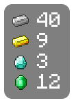
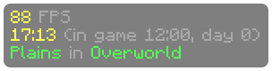

# Custom Script

Custom Script is an EvergreenHUD element that shows whatever you write, with live values from the game filled in as you play. Mix colors, bold text, sizes, icons, potion effects, items, choices and loops to build exactly the HUD you want.



## Getting started

1. Open the HUD editor with **Right Shift** and add **Custom Script**.
2. Select it and write in the **Script** box in its settings. The HUD changes as you type.
3. Not sure where to start? Pick a **Preset**, press **Load**, and change it from there.

A script is plain text. Anything in `{braces}` is filled in, and `&` codes add color:

```
&7X &f{block.x} &7Y &f{block.y} &7Z &f{block.z}
&cHealth &f{health}&7/{max_health}
```



The font, scale, shadow, background and padding you pick in the HUD Designer all still apply.

## Presets

Every preset is a starting point. Load one from the **Preset** dropdown and change whatever you like.

### Coordinates



```
{# Your block position, with your head and facing beside Y #}
&7&l[X] &r{block.x}
&7&l[Y] &r{block.y}{tab}  {head} {cardinal.short}
&7&l[Z] &r{block.z}
```

### Potion Effects



```
{# Each effect's icon, its name in the effect's own color, and the time left #}
{for e in effects}
{e.icon(2)} {e.color}&l{e.name}{if e.level > 1} {e.level | roman}{end}
{e.duration <= 10 ? "&c" : "&f"}{e.time}
{end}
```

### Player Stats



```
&cHealth {gradient(health, 0, max_health, "red", "yellow", "green")}{round(health, 1)}&7/{max_health}{if absorption > 0} &6+{round(absorption, 1)}{end}
&6Food &f{food} &7({round(saturation, 1)})
&bArmor &f{armor}
&aLevel &f{level} &7({round(xp * 100)}%)
```

### Armor



```
{for piece in armor_items}
{piece.icon} {if piece.max_durability}{gradient(piece.durability, 0, piece.max_durability, "red", "yellow", "green")}{piece.durability}{end}
{end}
{if held}
{held.icon} &f{held.name}{if held.count > 1} &7x{held.count}{end}
{end}
```

### Bed Wars Resources



```
{for id in ["iron_ingot", "gold_ingot", "diamond", "emerald"]}
{set resource = item(id)}
{resource.icon} {resource.count > 0 ? "&f" : "&8"}{resource.count}
{end}
```

### PvP

Your clicks per second, combo, reach and ping.

```
&bCPS &f{cps.left} &7| &f{cps.right}
&bCombo &f{combo}
&bReach &f{fixed(reach, 2)}
{if ping}&bPing {gradient(ping, 30, 200, "green", "yellow", "red")}{ping}ms{end}
```

### Info



```
&e{fps | smooth} &7FPS
&e{now("HH:mm")} &7(in game {time}, day {day})
&a{biome} &7in &a{dimension | replace("_", " ") | title}
{if not singleplayer}&b{server}{end}
```

## Where next

- [Text and values](text-and-values.md): colors, styles, live values and number formatting
- [Choices and loops](logic.md): show things only sometimes, and repeat lines for every effect or item
- [Colors, icons and layout](styling.md): gradients, sizes, icons, columns, update speed and smoothing
- [Examples](examples.md): ready-made scripts to copy
- [Reference](reference.md): every value and function
