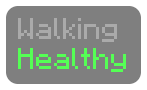
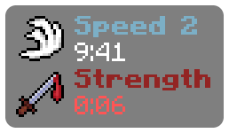

# Choices and loops

## Choices

Pick between two things with `condition ? this : that`, or use `{if}` blocks for whole lines:

```
{sprinting ? "&aRunning" : "&7Walking"}
{if health < 6}
&cLow health!
{elif health < 15}
&eGetting low
{else}
&aHealthy
{end}
```



Compare with `==`, `!=`, `<`, `<=`, `>` and `>=`, and combine with `and`, `or` and `not`. `in` checks whether something is in a list or a piece of text, as in `{if held.id in ["minecraft:bow", "minecraft:crossbow"]}`.

`0`, empty text, empty lists and missing values count as false, so `{if held}` means "if I'm holding something". `or` gives the first value that isn't false, which makes defaults easy: `{held.name or "Nothing"}`.

> [!NOTE]
> A line that ends up with nothing on it is hidden, so an `{if}` that is false or an empty value doesn't leave a gap. Blank lines you type yourself are kept.

## Loops

`{for ... in ...}` repeats everything up to its `{end}` once for every item in a list. Inside a loop, `loop.index` counts from 1, and `loop.first` and `loop.last` tell you where you are, which is handy for separators:

```
&7Effects: &f{for e in effects}{e.name}{if not loop.last}, {end}{end}
```


Loops can span several lines too. This one shows each effect with its icon, its name in the effect's own color and its level as a number, skips Jump Boost, and turns the time red in the last 10 seconds:

```
{for e in effects}
{if e.id not in ["jump_boost"]}
{e.icon(2)} {e.color}&l{e.name}{if e.level > 1} {e.level}{end}
{e.duration <= 10 ? "&c" : "&f"}{e.time}
{end}
{end}
```



> [!TIP]
> Lines with only `{if}`, `{for}`, `{end}` and the like on them disappear, so indenting your logic onto its own lines won't leave blank lines in the HUD.

Effect ids on 1.8.9 are `speed`, `slowness`, `haste`, `mining_fatigue`, `strength`, `instant_health`, `instant_damage`, `jump_boost`, `nausea`, `regeneration`, `resistance`, `fire_resistance`, `water_breathing`, `invisibility`, `blindness`, `night_vision`, `hunger`, `weakness`, `poison`, `wither`, `health_boost`, `absorption` and `saturation`. Not sure of one? Show `{e.id}` for a moment. You can also filter by kind, with `{if not e.ambient}` to hide beacon effects or `{if e.harmful}` to only show bad ones.

You can loop over lists you write yourself:

```
{for id in ["iron_ingot", "gold_ingot", "diamond", "emerald"]}{item(id).icon}&f{item(id).count}  {end}
```


## Your own variables

`{set name = value}` stores something to use later:

```
{set hp = health + absorption}
&cHP &f{round(hp, 1)}
```

## Comments

`{# anything in here is ignored #}`

## Mistakes

If the script can't be read, the HUD shows what is wrong and on which line:

```
&aHP {helth}
```


Problems while running, like dividing by zero, show in red where the value would have been, and the rest of the HUD keeps working:

```
&aSpeed {speed / 0} m/s
```


