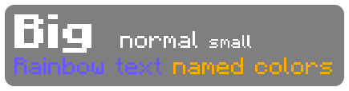
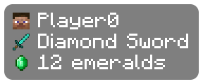
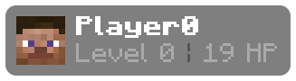
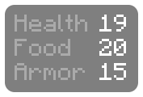
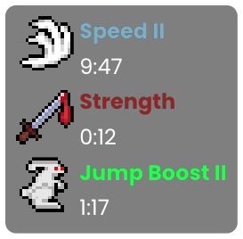

# Colors, icons and layout

## Colors

Colors can be values too. They change everything written after them on the line, just like `&` codes.

```
&cHP &l{gradient(health, 0, max_health, "red", "yellow", "green")}{repeat("|", health)}&8{repeat("|", max_health - health)}
```


| Write | Does |
| --- | --- |
| `{color("gold")}`, `{color("#FF8800")}`, `{color(255, 136, 0)}` | A color by name, hex or RGB |
| `{e.color}` | A potion effect's own color |
| `{gradient(health, 0, 20, "red", "yellow", "green")}` | A color that moves from red through yellow to green as health goes from 0 to 20 |
| `{blend("red", "blue", 0.5)}` | A mix of two colors |
| `{rainbow()}` | A cycling rainbow. `{rainbow(2)}` cycles twice as fast |

Color names are the Minecraft ones, like `red`, `dark_aqua` or `gold`, plus a few extras like `orange`, `pink` and `cyan`. `&c` and `c` work too.

## Sizes

`{size(...)}` makes the text after it bigger or smaller. Text of different sizes on the same line shares a baseline.

```
{size(2)}&lBig {size(1)}&rnormal {size(0.75)}small
{rainbow()}Rainbow text &r{color("gold")}named colors
```



## Icons

```
{head} {name}
{held.icon} {held.name}
{item("emerald").icon} {item("emerald").count} emeralds
```



| Write | Shows |
| --- | --- |
| `{head}` | Your player head |
| `{e.icon}` | A potion effect's icon |
| `{held.icon}`, `{helmet.icon}` | An item you're holding or wearing |
| `{item("emerald").icon}` | Any item |

Icons are one line tall. Make them taller with a number, like `{head(2)}` or `{e.icon(2)}`. A tall icon at the start of a line covers the lines below it too, and those lines move over so their text lines up beside it:

```
{head(2)} &l{name}
&7Level {level} &8| &7{round(health, 1)} HP
```



## Columns

`{tab}` lines text up in columns across lines:

```
&7Health{tab} &f{health}
&7Food{tab} &f{food}
&7Armor{tab} &f{armor}
```



## Update speed and smoothing

Each value refreshes as often as its own EvergreenHUD element does:

| Value | Refreshes |
| --- | --- |
| `fps` | Once a second |
| `ping` | Every half second, or every second on 1.8.9 |
| `memory`, `time` | Every half second |
| `day` | Once a second |
| `cps` | Ten times a second |
| `speed` | Twenty times a second, smoothed like the Speed element |
| Everything else | Twenty times a second |

Two functions change that for any number:

| Write | Does |
| --- | --- |
| `{ping \| every(2)}` | Only changes every 2 seconds. Use any number of seconds |
| `{fps \| smooth}` | Counts up or down to a new number instead of jumping. `smooth(1)` takes a second to get there instead of half a second |
| `{speed \| every(1) \| smooth}` | Both: a new number each second, counted up to |

They work on any number, like `{health | smooth}`, `{memory | smooth}`, `{cps.left | smooth}` or `{e.duration | every(5)}` inside a loop. `fps.live` is the frame rate right now, if you'd rather pick your own speed with `every`.

## Settings that still apply

Everything in the HUD Designer works on Custom Script: font, text scale, weight, bold and italic, case, alignment, text color, shadow, background and padding. Here's the potion preset with the Poppins font:



**Line Spacing** in the element's settings sets the gap between lines.

In the HUD editor, example effects and diamond gear stand in when you have no effects or no equipment, so you can see your layout without the real thing.
