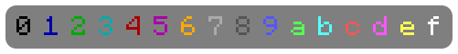
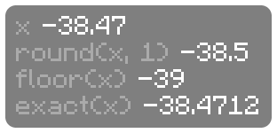

# Text and values

## Text and colors

Text shows exactly as you write it, and each line of the script is a line in the HUD. `&` codes change the color and style of everything after them.

```
&00 &11 &22 &33 &44 &55 &66 &77 &88 &99 &aa &bb &cc &dd &ee &ff
```



```
&lBold&r  &oItalic&r  &nUnderline&r  &mStrikethrough
&#FF8800Hex colors &#55CCFFlike these
```


| Code | Does |
| --- | --- |
| `&0` to `&9`, `&a` to `&f` | The 16 Minecraft colors |
| `&#FF8800` | Any hex color |
| `&l` `&o` `&n` `&m` | Bold, italic, underline, strikethrough |
| `&r` | Back to the HUD's own color, style and size |

`§` works the same as `&`. Unlike vanilla, a color doesn't turn off bold and the like, so `&l&0` and `&0&l` are both bold black. Only `&r` resets, and every line starts fresh.

> [!TIP]
> Write `\{`, `\}` or `\&` to show those characters as text, `\n` for a new line and `\t` for a [column](styling.md#columns).

## Values

Anything in `{braces}` is filled in with a live value:

```
&7X &f{block.x} &7Y &f{block.y} &7Z &f{block.z}
&cHealth &f{health}&7/{max_health}
```


Some values have parts, reached with a dot, like `{facing.short}`, `{held.name}` or `{memory.used}`. Writing the value on its own, like `{facing}` or `{held}`, shows its name. The [reference](reference.md) lists them all.

You can do math, like `{health / max_health * 100}`, and join text, like `{"HP: " + health}`.

## Numbers

Values look and refresh the same way as the EvergreenHUD element that shows them. `{x}` shows `-38.47` and `{y}` shows `72.00`, like the Position element, and `{fps}` changes once a second, like the FPS element. Numbers you work out yourself show up to 2 decimal places.

```
&7x &f{x}
&7round(x, 1) &f{round(x, 1)}
&7floor(x) &f{floor(x)}
&7exact(x) &f{x | exact}
```



| Write | Shows |
| --- | --- |
| `{round(x, 1)}` | `-38.5` |
| `{fixed(x, 3)}` | `-38.471`, always with 3 decimals |
| `{floor(x)}` | `-39` |
| `{x \| exact}` | Every digit the number has, like `-38.4712` |
| `{signed(y)}` | `+72` |

`exact` is great for reach: `{reach | exact}` shows it to about 15 decimals.

## Pipes

`{value | function}` passes the value to a function, which reads nicely for formatting, like `{name | upper}`, `{x | round(1)}` or `{e.level | roman}`. You can chain them:

```
{dimension | replace("_", " ") | title}
```

turns `the_nether` into `The Nether`.
